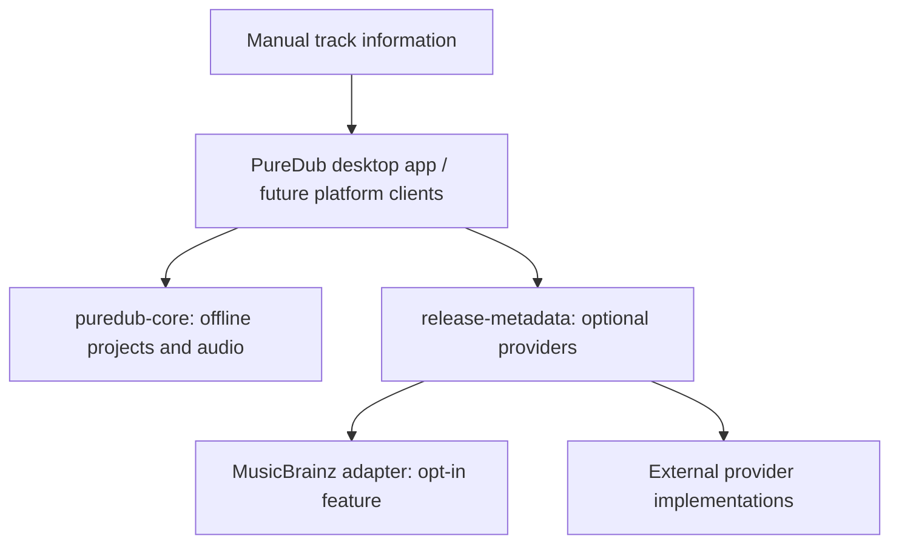

# Shared library architecture

PureDub is now three independent repositories. This extraction reuses the existing
desktop client; it does not add a new client, live recorder or mobile binding layer.

## Ownership

- **Core** owns validated PCM, waveform analysis, quiet-region suggestions,
  project serialization, cut ranges, FLAC encoding/tagging and post-tagging
  sample comparison. It never calls a metadata provider.
- **Metadata** owns provider-qualified release IDs, release/media/track data and
  the blocking provider trait. The MusicBrainz feature adds request pacing,
  HTTP/JSON parsing and source attribution. The default build has no HTTP client.
- **Applications** own file selection/permissions, background execution, playback,
  manual entry and conversion between provider tracks and editable Core tracks.
  A source duration is assistance, never an authoritative audio boundary.

The desktop conversion is in `src/metadata.rs`; service HTTP code is in the
release-metadata repository. It selects cassette media and maps missing/unsupported
A/B labels to `?` for review. Core treats the old project `release_id` string as
opaque; a future project-format revision can preserve richer provider provenance
without forcing Core to depend on the metadata crate.

## Compatibility

Version-1 project JSON and the desktop command-line/file workflows are retained.
Both libraries are 0.1 APIs. Each is released separately, and this app pins the
exact tested Git revisions. Neither has been published to crates.io yet.

Windows synthetic tests and desktop compilation are checked locally. Both library
repositories have active GitHub Actions checks for Windows, Linux and macOS.
Android/iOS compilation, packaging, storage,
audio playback and binding generation remain future validation work.

## Next evidence

With the Scarlett 2i2 available, create a short known stereo capture using existing
recording software. Verify that left and right remain independent, confirm the
actual WAV sample rate/bit depth, and test reviewed cuts and FLAC reassembly.
Report real hardware evidence separately from the current synthetic fixtures.
Live recording integration is still separate work.

Then validate a small Android consumer before extending public APIs for mobile.
Long high-resolution sides currently expand to `i32` in RAM; chunked processing
and mobile background/export behavior need work before claiming mobile readiness.
Swift/Kotlin bindings can be introduced when those clients are started, rather
than committing to a foreign-language API without a consumer.
